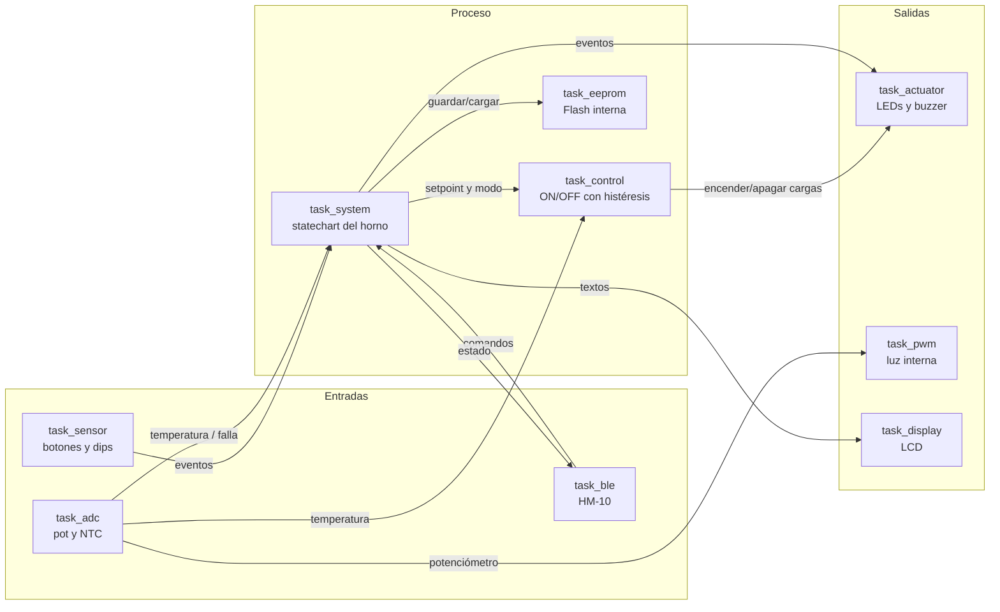
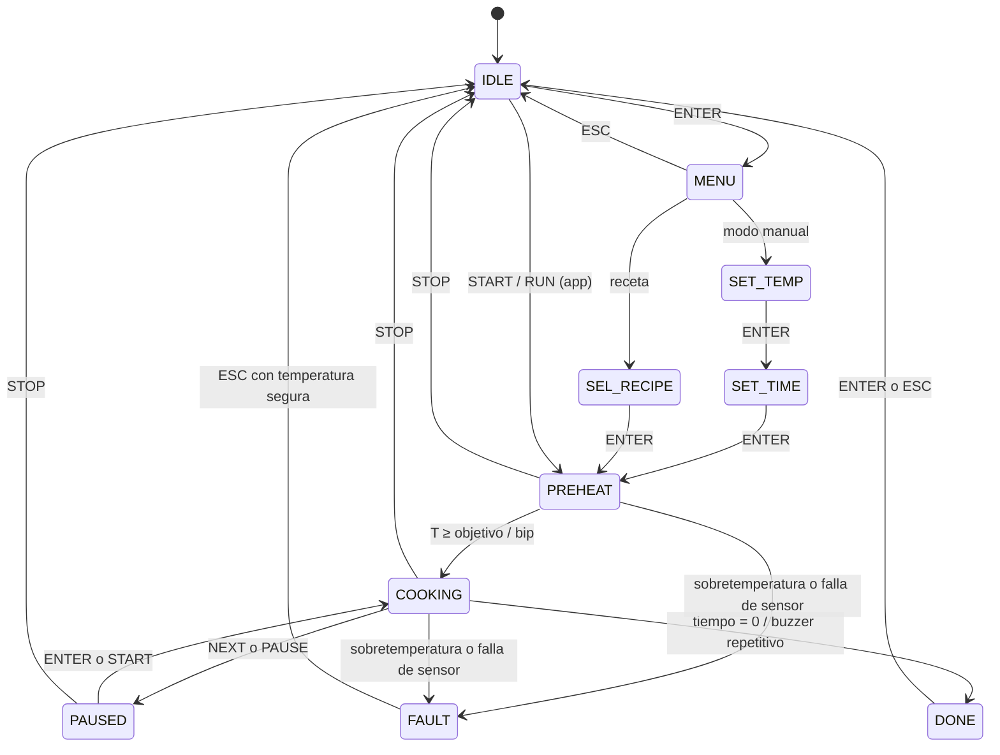

  

# Sistema Controlador de Horno Gastronómico Eléctrico Inteligente

## Memoria técnica del Trabajo Final

FIUBA - Electrónica - TA134 Taller de Sistemas Embebidos - Trabajo Final - 2026-2doC - Curso 1 - Grupo 02

> ⚠️ **Nota para el grupo (borrar antes de entregar):** este documento es el esqueleto de la memoria. Todo lo que falta medir, fotografiar o confirmar está marcado con bloques como este o con `[completar]`. Para encontrarlos, buscar "⚠️" y "[completar]" en el archivo.

### Autores

| Padrón | Apellidos, Nombres |
| :----- | :----------------- |
| 107453 | Del Cioppo, Matías |
| 109609 | Ferrua, Luciano Andrés |
| 112572 | Franco, Lautaro Ignacio |

### Registro de versiones

| Versión | Fecha | Cambios |
| :-----: | :---: | :------ |
| 0.1 | 24/11/2026 | Esqueleto inicial de la memoria, con la historia del desarrollo hasta la prueba integral en protoboard. |
| 0.2 | [completar] | Mediciones (WCET, factor de uso, consumo, *Build Analyzer*), fotos de la placa soldada y video. |
| 1.0 | [completar] | Versión final entregada. |

---

## Índice general

- [Capítulo 1: Introducción general](#capítulo-1-introducción-general)
  - [1.1 Análisis de necesidad y objetivo](#11-análisis-de-necesidad-y-objetivo)
  - [1.2 Diagrama en bloques general](#12-diagrama-en-bloques-general)
  - [1.3 Productos comerciales disponibles](#13-productos-comerciales-disponibles)
  - [1.4 Justificación del enfoque técnico](#14-justificación-del-enfoque-técnico)
  - [1.5 Alcance y limitaciones](#15-alcance-y-limitaciones)
- [Capítulo 2: Introducción específica](#capítulo-2-introducción-específica)
  - [2.1 Requisitos](#21-requisitos)
  - [2.2 Casos de uso](#22-casos-de-uso)
  - [2.3 Descripción de módulos principales](#23-descripción-de-módulos-principales)
    - [2.3.1 Placa NUCLEO-F103RB](#231-placa-nucleo-f103rb)
    - [2.3.2 Display LCD 16×2](#232-display-lcd-162)
    - [2.3.3 Termistor NTC 100 kΩ](#233-termistor-ntc-100-kω)
    - [2.3.4 Módulo Bluetooth HM-10](#234-módulo-bluetooth-hm-10)
    - [2.3.5 Aplicación móvil](#235-aplicación-móvil)
- [Capítulo 3: Diseño e implementación](#capítulo-3-diseño-e-implementación)
  - [3.1 Proceso de desarrollo](#31-proceso-de-desarrollo)
  - [3.2 Diseño de hardware](#32-diseño-de-hardware)
    - [3.2.1 Criterio de interconexión y montaje](#321-criterio-de-interconexión-y-montaje)
    - [3.2.2 Asignación de pines](#322-asignación-de-pines)
    - [3.2.3 Esquema eléctrico y circuitos de cada módulo](#323-esquema-eléctrico-y-circuitos-de-cada-módulo)
    - [3.2.4 Elección de la resistencia del divisor de la NTC](#324-elección-de-la-resistencia-del-divisor-de-la-ntc)
    - [3.2.5 Etapa de potencia y presupuesto de corriente](#325-etapa-de-potencia-y-presupuesto-de-corriente)
  - [3.3 Diseño de firmware](#33-diseño-de-firmware)
    - [3.3.1 Arquitectura: ejecutivo cíclico y Event-Triggered System](#331-arquitectura-ejecutivo-cíclico-y-event-triggered-system)
    - [3.3.2 Tareas](#332-tareas)
    - [3.3.3 Máquina de estados del sistema](#333-máquina-de-estados-del-sistema)
    - [3.3.4 Medición de temperatura](#334-medición-de-temperatura)
    - [3.3.5 Control de temperatura](#335-control-de-temperatura)
    - [3.3.6 Persistencia en Flash interna](#336-persistencia-en-flash-interna)
    - [3.3.7 Comunicación BLE](#337-comunicación-ble)
    - [3.3.8 Fragmentos de código relevantes](#338-fragmentos-de-código-relevantes)
    - [3.3.9 Pantallas del LCD](#339-pantallas-del-lcd)
- [Capítulo 4: Ensayos y resultados](#capítulo-4-ensayos-y-resultados)
  - [4.1 Pruebas funcionales del hardware](#41-pruebas-funcionales-del-hardware)
  - [4.2 Pruebas funcionales del firmware](#42-pruebas-funcionales-del-firmware)
  - [4.3 Pruebas de integración](#43-pruebas-de-integración)
  - [4.4 Console y Build Analyzer](#44-console-y-build-analyzer)
  - [4.5 Medición y análisis de WCET por tarea](#45-medición-y-análisis-de-wcet-por-tarea)
  - [4.6 Cálculo del factor de uso de CPU](#46-cálculo-del-factor-de-uso-de-cpu)
  - [4.7 Medición y análisis de consumo](#47-medición-y-análisis-de-consumo)
  - [4.8 Gestión de bajo consumo](#48-gestión-de-bajo-consumo)
  - [4.9 Cumplimiento de requisitos](#49-cumplimiento-de-requisitos)
  - [4.10 Comparación con sistemas similares](#410-comparación-con-sistemas-similares)
  - [4.11 Documentación del desarrollo realizado](#411-documentación-del-desarrollo-realizado)
- [Capítulo 5: Conclusiones](#capítulo-5-conclusiones)
  - [5.1 Resultados obtenidos](#51-resultados-obtenidos)
  - [5.2 Lecciones aprendidas](#52-lecciones-aprendidas)
  - [5.3 Próximos pasos](#53-próximos-pasos)
- [Capítulo 6: Uso de herramientas de IA](#capítulo-6-uso-de-herramientas-de-ia)
- [Capítulo 7: Bibliografía y referencias](#capítulo-7-bibliografía-y-referencias)

---

## Capítulo 1: Introducción general

### 1.1 Análisis de necesidad y objetivo

Los hornos eléctricos de uso doméstico y gastronómico de gama media suelen controlarse con un termostato mecánico y un temporizador a cuerda. Con ese esquema la temperatura real del recinto no se conoce, el tiempo de cocción depende de que el usuario esté presente y no existe ningún aviso ante una sobretemperatura. Los modelos que agregan conectividad lo hacen a un precio considerablemente mayor y, en general, dependiendo de una plataforma en la nube cerrada.

El objetivo del trabajo fue diseñar e implementar un prototipo de controlador de horno eléctrico inteligente, del tipo PMV (Producto Mínimo Viable), basado en la placa de desarrollo NUCLEO-F103RB [1]. El controlador permite:

- Medir en tiempo real la temperatura del recinto mediante un termistor NTC (*Negative Temperature Coefficient*).
- Fijar la temperatura objetivo y el tiempo de cocción desde un menú local en un display LCD (*Liquid Crystal Display*) de 16×2 caracteres.
- Elegir la fuente de calor (resistencia superior, inferior y convección) con un bloque de *dip switches*.
- Regular la luz interna del horno con un potenciómetro y una salida PWM (*Pulse Width Modulation*).
- Monitorear y comandar la cocción desde un teléfono celular, mediante un módulo BLE (*Bluetooth Low Energy*) HM-10.
- Guardar recetas y la última configuración en memoria no volátil.
- Señalizar el estado con LEDs y un *buzzer*, y pasar a un modo de falla seguro ante sobretemperatura o falla del sensor.

### 1.2 Diagrama en bloques general

El sistema se organizó en tres grupos de módulos alrededor del microcontrolador: entradas y sensores, salidas y actuadores, y comunicación y memoria no volátil. Esta organización se ilustra en la figura 1.1.

<em>Figura 1.1: Diagrama en bloques general del controlador de horno. A la izquierda, las entradas (botones, dip switches, potenciómetro y sensor de temperatura); al centro, la NUCLEO-F103RB; a la derecha, las salidas (LCD, buzzer, LEDs y etapa de potencia) y abajo la comunicación BLE y la memoria no volátil.</em>

> ⚠️ **Pendiente:** la figura 1.1 es la de [PROPUESTA.md](PROPUESTA.md). Todavía muestra el teclado 4×3, la EEPROM externa y los relés. Decidir si se deja tal cual (como diagrama "de la idea") o si se actualiza con lo que quedó finalmente: 3 botones + B1, Flash interna y LEDs en lugar de relés.

### 1.3 Productos comerciales disponibles

En el mercado argentino se identificaron dos familias de productos comparables, que se resumen en la tabla 1.1.

<em>Tabla 1.1: Productos comerciales similares al trabajo propuesto.</em>

| Producto | Tipo | Características principales | Limitaciones | Enlace |
| :--- | :--- | :--- | :--- | :---: |
| Hornos eléctricos digitales *smart* (ej. Yelmo, Smartlife) | Horno completo | Display, selección de resistencias, Wi-Fi/Bluetooth mediante plataformas genéricas (Tuya / Smart Life). | App cerrada y genérica: encendido y temporizado simple, sin recetas por etapas. *Firmware* propietario. | [completar] |
| Controladores térmicos con conectividad (ej. Inkbird ITC) | Termostato externo | Lectura de temperatura en el celular y alertas. | No gestionan los actuadores propios de un horno (resistencias independientes, convección, luz). | [completar] |
| Hornos de ecosistema cerrado (ej. Xiaomi Smart Oven) | Horno completo | Recetas desde la app, control remoto. | Requieren conexión a la nube; sin almacenamiento local de recetas para operar sin internet. Precio elevado. | [completar] |

> ⚠️ **Pendiente:** agregar el link a cada producto y, si se puede, el precio de referencia.

### 1.4 Justificación del enfoque técnico

Para elegir el proyecto se compararon tres alternativas (controlador completo con STM32, controlador básico con STM32 y termostato con Arduino UNO) con seis criterios ponderados. El detalle de esa comparación está en la sección 1.2 de [PROPUESTA.md](PROPUESTA.md). Se eligió el controlador completo porque obtuvo el mayor puntaje (439 contra 354 y 314) y porque permitía integrar todos los contenidos del curso: GPIO, ADC (*Analog to Digital Converter*), *timers* y PWM, UART (*Universal Asynchronous Receiver-Transmitter*), interrupciones, memoria no volátil y máquinas de estado.

Además, el diseño se apoyó en los trabajos prácticos previos de la materia. El proyecto del TP3 (menú de configuración con LCD y botones) aportó la arquitectura base y el manejo del display, y el TP4 aportó el ADC y el PWM. Esto permitió reutilizar código ya probado y concentrar el esfuerzo en la lógica propia del horno.

### 1.5 Alcance y limitaciones

El trabajo se planteó como un prototipo que controla y señaliza, no como un horno funcional conectado a la red eléctrica. En consecuencia:

- Las resistencias calefactoras y el ventilador de convección se representaron con LEDs. La etapa de potencia real (relés o relés de estado sólido con su propio *driver*) quedó fuera del alcance, como se explica en la sección 2.1.
- La temperatura se midió con una NTC de 100 kΩ, adecuada hasta unos 250 °C. Por eso la temperatura máxima configurable se limitó a 230 °C.
- La app móvil se resolvió con una aplicación de terminal BLE con botones programables. [completar si finalmente se hace una app propia, por ejemplo en MIT App Inventor]

---

## Capítulo 2: Introducción específica

### 2.1 Requisitos

Los requisitos originales se definieron en la Tabla 2 de [PROPUESTA.md](PROPUESTA.md) y se reproducen en la tabla 2.1. Durante el desarrollo algunos se modificaron; los cambios y su justificación se resumen en la tabla 2.2.

<em>Tabla 2.1: Requisitos originales del proyecto.</em>

| Grupo | ID | Descripción |
| :--- | :---: | :--- |
| Sensores | 1.1 | El sistema medirá periódicamente la temperatura interna del horno mediante un sensor térmico (NTC / termocupla) conectado al ADC o SPI del STM32. |
| | 1.2 | El sistema utilizará un potenciómetro analógico (ADC) para el ajuste fino de intensidad de luz interna o de parámetros numéricos. |
| Interfaz LCD | 2.1 | El sistema contará con una pantalla LCD (2x16 / 20x4) para visualización del menú navegable. |
| | 2.2 | El sistema mostrará en el LCD una pantalla de bienvenida y estado en reposo (`IDLE`) al encender. |
| | 2.3 | El sistema mostrará en el LCD la temperatura actual medida y la temperatura objetivo durante el proceso de cocción. |
| | 2.4 | El sistema mostrará en el LCD el tiempo restante del temporizador de cocción. |
| | 2.5 | El sistema mostrará un mensaje de alerta explícito en el LCD cuando ocurra una sobretemperatura o falla. |
| Entradas / controles | 3.1 | El sistema contará con un teclado matricial/botones (`Enter`, `Next`, `Escape`) para la navegación del menú y confirmación de valores. |
| | 3.2 | El sistema implementará filtrado de antirrebote (*debounce*) por software para todos los botones de entrada. |
| | 3.3 | El sistema contará con un bloque de dip switches para la selección directa de la fuente de calor (superior, inferior, ambas, convección). |
| Indicadores luminosos | 4.1 | LED indicador de encendido/reposo (`IDLE`). |
| | 4.2 | LED indicador de resistencias activas (`HEATING`). |
| | 4.3 | LED indicador de temperatura objetivo alcanzada (`SETPOINT OK`). |
| | 4.4 | Notificación de alarma o falla mediante titileo de los LEDs indicadores. |
| Actuadores y potencia | 5.1 | Control de las resistencias (superior/inferior) mediante salidas digitales hacia relés/MOSFETs. |
| | 5.2 | Regulación de la luz interna mediante PWM. |
| Buzzer | 6.1 | Melodía corta al confirmar un menú o el inicio de cocción. |
| | 6.2 | Patrón sonoro repetitivo al finalizar el tiempo de cocción. |
| | 6.3 | Tono continuo ante sobretemperatura o estado de FALLA. |
| Comunicación BLE | 7.1 | Comunicación con la app mediante el módulo HM-10 (UART). |
| | 7.2 | Envío periódico a la app de la temperatura y del estado del temporizador. |
| | 7.3 | Recepción desde la app de comandos de inicio, pausa y parada de emergencia. |
| | 7.4 | Recepción desde la app de perfiles o parámetros de recetas. |
| | 7.5 | Notificación a la app de alarmas de sobretemperatura o cancelación. |
| Memoria | 8.1 | Almacenamiento de las recetas en EEPROM externa (I2C) o Flash interna. |
| | 8.2 | Recuperación de la última configuración válida al iniciar. |
| Arquitectura de firmware | 9.1 | *Firmware* modular *bare metal* con patrón *super-loop*. |
| | 9.2 | Base de tiempo de 1 ms (*SysTick*) para tareas no bloqueantes. |
| | 9.3 | Lógica principal organizada en máquinas de estados finitos. |

<em>Tabla 2.2: Cambios de requisitos durante el desarrollo.</em>

| ID | Cambio | Motivo |
| :---: | :--- | :--- |
| 1.1 | Se usó solo la NTC por ADC; se descartó la termocupla tipo K con MAX6675 (SPI). | La NTC ya estaba disponible y su rango alcanza para el prototipo. Simplificó el *hardware*. |
| 1.2 | El potenciómetro se usa solo para la intensidad de la luz interna. | La temperatura y el tiempo se fijan con el menú y con la app; usar la perilla para ambas cosas resultaba confuso. |
| 2.1 | Se usó el LCD 16×2 del TP3. | Reutilización del *hardware* y del *driver* ya portado. |
| 3.1 | Se reemplazó el teclado matricial por 3 botones (ENTER, NEXT, ESC) más el botón de usuario de la placa (B1) como STOP. Se descartó un cuarto botón. | El menú se navega con 3 teclas, igual que en el TP3. La parada también está disponible desde la app. |
| 4.1 a 4.3 | Los tres LEDs indicadores se unificaron en un LED RGB. | Reutilizar un módulo y código de trabajos prácticos anteriores y simplificar el cableado. [completar: confirmar pines y colores finales] |
| 5.1 | Los relés se reemplazaron por LEDs (uno por resistencia y uno por el ventilador). | Al calcular las corrientes se comprobó que manejar las bobinas de los relés desde la placa superaba los límites de la hoja de datos. |
| 8.1 | Se usó la Flash interna en lugar de una EEPROM externa. | Menos conexiones y un periférico menos (se liberó el I2C1). |
| Nuevo | ESC funciona como STOP en dos pasos durante la cocción: la primera pulsación pide confirmación y la segunda cancela. | Evitar cancelar una cocción por un toque accidental. El STOP de B1 y el de la app siguen siendo inmediatos. |

### 2.2 Casos de uso

Los casos de uso se tomaron de la sección 2.2 de [PROPUESTA.md](PROPUESTA.md) y se ajustaron a lo implementado. Se presentan en las tablas 2.3 a 2.5.

<em>Tabla 2.3: Caso de uso 1, configuración e inicio de cocción desde el panel local.</em>

| Elemento | Definición |
| :--- | :--- |
| **Disparador** | El usuario quiere iniciar una cocción configurando los parámetros desde el panel frontal. |
| **Precondiciones** | El sistema está encendido en reposo (`IDLE`) y el sensor de temperatura funciona correctamente. |
| **Flujo básico** | 1. El usuario elige la fuente de calor con los dip switches (DIP1 superior, DIP2 inferior, DIP3 convección). 2. Con ENTER entra al menú y elige el modo manual o una receta. 3. Con NEXT ajusta la temperatura objetivo y el tiempo, y confirma cada valor con ENTER. 4. El sistema pasa a precalentamiento (`PREHEAT`), enciende los LEDs de las resistencias elegidas y muestra en el LCD la temperatura medida y la objetivo. 5. Al alcanzar la temperatura objetivo suena un aviso y comienza la cuenta regresiva (`COOKING`). 6. Al terminar el tiempo se apagan las resistencias y el *buzzer* emite un patrón repetitivo (`DONE`). |
| **Flujos alternativos** | a. Sobretemperatura o sensor abierto/en corto: el sistema apaga todo, pasa a `FAULT`, muestra la alerta en el LCD, hace titilar los LEDs y activa el *buzzer* continuo. b. Cancelación con ESC: el LCD pide confirmación; un segundo ESC cancela y vuelve a reposo, y ENTER o 5 s sin respuesta continúan la cocción. c. Pausa con NEXT: se apagan las resistencias y se detiene el tiempo; ENTER reanuda. |

<em>Tabla 2.4: Caso de uso 2, control y monitoreo remoto por BLE.</em>

| Elemento | Definición |
| :--- | :--- |
| **Disparador** | El usuario consulta o comanda el horno desde el celular. |
| **Precondiciones** | El HM-10 está vinculado con el celular y el control remoto está habilitado (DIP4). |
| **Flujo básico** | 1. El horno envía cada 1 s una línea de estado `ST:<estado>,T:<temp>,SP:<objetivo>,R:<mm:ss>`. 2. El usuario envía `SET:<temp>,<min>` o `RUN:<n>` para cargar parámetros o una receta guardada. 3. El horno responde `OK:<comando>`, actualiza el LCD y, con `START`, inicia la cocción. 4. El horno informa el progreso con `INFO:START`, `INFO:PREHEAT_DONE` e `INFO:DONE`. |
| **Flujos alternativos** | a. Parámetros fuera de rango: el horno responde `ERR:SET` y no cambia nada. b. Pérdida de la conexión BLE: el horno sigue la cocción en curso de forma autónoma. |

<em>Tabla 2.5: Caso de uso 3, parada de emergencia.</em>

| Elemento | Definición |
| :--- | :--- |
| **Disparador** | El usuario detecta una anomalía (olor a quemado, humo) y quiere cortar la cocción de inmediato. |
| **Precondiciones** | Hay una cocción en curso. |
| **Flujo básico** | 1. El usuario presiona B1 en el panel o envía `STOP` desde la app. 2. El sistema apaga las resistencias, el ventilador y la luz. 3. El *buzzer* emite un aviso breve, el LCD muestra la cancelación y la app recibe `ALARM:CANCELLED`. 4. El sistema vuelve a reposo. |
| **Flujos alternativos** | a. Sin conexión BLE: se usa B1 o ESC (en dos pasos). b. Si antes se supera el límite de temperatura, el sistema pasa solo a `FAULT`. |

### 2.3 Descripción de módulos principales

En esta sección se describen los componentes que se usaron pero que no fueron diseñados por el grupo.

#### 2.3.1 Placa NUCLEO-F103RB

La NUCLEO-F103RB [1] tiene un microcontrolador STM32F103RB [2] con núcleo ARM Cortex-M3 a 64 MHz, 128 KB de Flash y 20 KB de RAM. Se eligió porque es la placa de la materia y porque ya se habían usado sus periféricos en los trabajos prácticos. Los pines que no están en los conectores tipo Arduino se tomaron de los conectores *morpho* CN7 y CN10, según el manual UM1724 [3].

#### 2.3.2 Display LCD 16×2

Display de caracteres con controlador HD44780 [4], manejado en modo de 4 bits por GPIO. Se reutilizó el *driver* portado en el TP3, en el que las demoras se resolvieron sin bloquear el *super-loop*.

#### 2.3.3 Termistor NTC 100 kΩ

Termistor NTC de 100 kΩ a 25 °C con coeficiente B = 3950 K [5], conectado en un divisor resistivo a 3,3 V. La conversión de resistencia a temperatura se hizo con la ecuación del parámetro B, que se presenta en la subsección 3.3.4.

#### 2.3.4 Módulo Bluetooth HM-10

Módulo BLE basado en el CC2541 [6] que expone un puerto serie transparente a 9600 bps a través del servicio `FFE0` y la característica `FFE1`. Por ser BLE, no lo reconocen las aplicaciones pensadas para Bluetooth clásico (como las del HC-05/HC-06), y los datos viajan en paquetes de hasta 20 bytes.

#### 2.3.5 Aplicación móvil

[completar: Serial Bluetooth Terminal [7] con botones programados (M1 `START`, M2 `PAUSE`, M3 `STOP`, M4 `STATUS`) y fin de línea LF, y/o la app propia en MIT App Inventor [8]. Incluir captura de pantalla como figura 2.1.]

---

## Capítulo 3: Diseño e implementación

### 3.1 Proceso de desarrollo

El trabajo se desarrolló en etapas, que se resumen en la tabla 3.1. Las entregas intermedias están registradas en la bitácora del [README.md](README.md).

<em>Tabla 3.1: Etapas del desarrollo del trabajo.</em>

| Fecha | Etapa | Resultado |
| :---: | :--- | :--- |
| 07/10/2026 | Entrega 01: README y bitácora | Repositorio creado y docentes invitados. |
| 30/10/2026 | Entrega 02: [PROPUESTA.md](PROPUESTA.md) | Selección del proyecto, 29 requisitos y 3 casos de uso. Hubo correcciones del flujo de *pull requests* antes de su aprobación. |
| [completar] | *Firmware* base | Se unió la arquitectura del TP3 (super-loop, *tick* de 1 ms, máquinas de estado, LCD y botones) con el ADC y el PWM del TP4. Se agregaron las tareas nuevas: control, BLE y memoria. Se validó la lógica con una simulación en PC antes de tener el *hardware* armado (ver sección 4.2). |
| [completar] | Asignación de pines | Se remapearon periféricos para evitar conflictos entre el TP3 y el TP4 (ver subsección 3.2.2). |
| [completar] | Cambios de *hardware* | EEPROM externa reemplazada por Flash interna; relés reemplazados por LEDs; resistencia fija de la NTC cambiada de 4,7 kΩ a 1 kΩ y límites de temperatura ajustados al rango de la NTC. |
| 20/11/2026 | Entrega 03: [Informe de Avance](Informe_de_Avance.md) | Primeras pruebas por módulo en protoboard. En ese momento estaban implementados pero sin probar el tiempo restante y la alerta de falla en el LCD (2.4, 2.5); faltaban configurar la melodía y el tono de falla del *buzzer* (6.1, 6.3), el titileo de los LEDs (4.4) y el PWM de la luz (5.2); y los comandos recibidos por BLE todavía no ejecutaban la acción pedida (7.3, 7.4). Ya se habían decidido los LEDs en lugar de relés y el LED RGB. |
| [completar] | Depuración en protoboard | Se resolvieron fallas del LCD (conexionado) y un error de inicialización del actuador que dejaba apagado el LED de reposo (ver sección 4.2). Se completaron los pendientes del informe de avance y se verificó que los comandos BLE ejecutaran la acción correspondiente. [completar: qué se cambió para que funcionaran los comandos, el *buzzer* y el PWM] |
| [completar] | Prueba integral en protoboard | Funcionamiento completo del sistema con todos los periféricos conectados. |
| [completar] | Armado en placa experimental soldada | [completar] |
| [completar] | Mediciones, video y memoria final | [completar] |

### 3.2 Diseño de hardware

#### 3.2.1 Criterio de interconexión y montaje

La validación de cada módulo se hizo primero en protoboard, conectando los periféricos a la NUCLEO-F103RB con cables. Una vez verificado el funcionamiento integral, el prototipo se montó sobre una placa experimental con los componentes y conectores soldados y las interconexiones hechas con cable soldado, como exigen las pautas del trabajo.

> ⚠️ **Pendiente:** describir cómo quedó la placa soldada: tipo de placa, conectores usados para unirla a la Nucleo (tiras de pines a los morpho, etc.), cómo se alimenta y fotos (figuras 3.x).

#### 3.2.2 Asignación de pines

La asignación de pines partió de la de los trabajos prácticos, para reutilizar el conexionado del LCD y de los botones. Hubo tres conflictos, que se resolvieron así:

- El PWM del TP4 estaba en PA6, que en el TP3 es el botón ESC. Se movió a TIM3_CH3 en PB0.
- Los pines por defecto de USART3 (PB10/PB11) chocaban con el dato D6 del LCD en PB10. Se usó el *partial remap* de USART3 a PC10/PC11.
- Los pines por defecto del I2C1 chocaban con el botón ENTER (PB6). Se usó el *remap* a PB8/PB9. Este periférico se eliminó después, al pasar a la Flash interna.

La asignación final se presenta en la tabla 3.2.

<em>Tabla 3.2: Asignación de pines de la NUCLEO-F103RB.</em>

| Función | Periférico | Pin del micro | Pin Arduino / morpho |
| :--- | :--- | :---: | :---: |
| LCD RS | GPIO salida | PA9 | D8 |
| LCD E | GPIO salida | PC7 | D9 |
| LCD D4 / D5 / D6 / D7 | GPIO salida | PB5 / PB4 / PB10 / PA8 | D4 / D5 / D6 / D7 |
| Botón ENTER | GPIO entrada, *pull-up* | PB6 | D10 |
| Botón NEXT | GPIO entrada, *pull-up* | PA7 | D11 |
| Botón ESC | GPIO entrada, *pull-up* | PA6 | D12 |
| Botón STOP (B1 de la placa) | GPIO entrada | PC13 | — |
| DIP1 (superior) / DIP2 (inferior) | GPIO entrada, *pull-up* | PC0 / PC1 | A5 / A4 |
| DIP3 (convección) / DIP4 (habilita BLE) | GPIO entrada, *pull-up* | PC2 / PC3 | CN7-35 / CN7-37 |
| Potenciómetro | ADC1_IN0 | PA0 | A0 |
| NTC | ADC1_IN1 | PA1 | A1 |
| Luz interna | TIM3_CH3 (PWM) | PB0 | A3 |
| HM-10 RXD / TXD | USART3 TX / RX (*partial remap*), 9600 bps | PC10 / PC11 | CN7-1 / CN7-2 |
| LED resistencia superior / inferior / ventilador | GPIO salida | PC4 / PC5 / PC6 | CN10-34 / CN10-6 / CN10-4 |
| LEDs de estado IDLE / HEATING / SETPOINT (LED RGB) | GPIO salida | PC8 / PC9 / PB12 | CN10-2 / CN10-1 / CN10-16 |
| *Buzzer* | GPIO salida | PB13 | CN10-30 |

> ⚠️ **Pendiente:** confirmar la tabla contra el `.ioc` final, sobre todo los pines del LED RGB.

#### 3.2.3 Esquema eléctrico y circuitos de cada módulo

El esquema completo se presenta en la figura 3.1. Los criterios de diseño de cada circuito fueron los siguientes:

- Botones y dip switches: se conectaron entre el pin y GND, con la resistencia de *pull-up* interna del micro. Por eso no llevan resistencias externas y son activos en bajo.
- LEDs: cada uno con una resistencia serie de 330 Ω. [completar: resistencias del LED RGB]
- *Buzzer*: es un *buzzer* activo de 5 V manejado con un transistor NPN (BC337 / 2N2222) y 1 kΩ en la base, porque su consumo supera lo recomendable para un pin del micro.
- NTC: divisor entre 3,3 V y GND con la resistencia fija arriba y la NTC abajo (ver subsección 3.2.4). Nunca se alimentó a 5 V, porque la entrada del ADC no lo tolera.
- Potenciómetro: entre 3,3 V y GND, con el cursor al ADC.
- HM-10: conexión cruzada (TXD del módulo al RX del micro y viceversa), alimentado a [completar: 5 V o 3,3 V según el módulo].
- LCD: alimentado a 5 V, RW a GND y contraste con un *trimpot* de 10 kΩ.

<em>Figura 3.1: Esquema eléctrico del controlador. [completar descripción]</em>

> ⚠️ **Pendiente:** dibujar el esquema (KiCad, Fritzing o similar) y exportarlo a `imagenes/memoria/esquema_electrico.png`. Agregar también vistas del cableado como en el libro de la materia [9].

#### 3.2.4 Elección de la resistencia del divisor de la NTC

Con la NTC abajo y la resistencia fija arriba, la tensión en la entrada del ADC es la de la ecuación (3.1):

$$V_{ADC} = 3{,}3\ \text{V} \cdot \frac{R_{NTC}}{R_{NTC} + R_{fija}} \tag{3.1}$$

La resistencia de la NTC sigue la ecuación del parámetro B (3.2), con $R_0 = 100\ \text{k}\Omega$, $T_0 = 298{,}15\ \text{K}$ y $B = 3950\ \text{K}$:

$$R_{NTC}(T) = R_0 \cdot e^{B\left(\frac{1}{T} - \frac{1}{T_0}\right)} \tag{3.2}$$

En el rango de cocción la NTC baja a valores del orden de 1 kΩ (por ejemplo, unos 0,74 kΩ a 200 °C). Con la resistencia fija original de 4,7 kΩ, la tensión quedaba comprimida cerca de 0 V y la resolución en ese rango era pobre. Por eso se cambió a 1 kΩ, que ubica la tensión cerca de la mitad del rango del ADC en la zona de trabajo. En el *firmware*, el valor de la resistencia fija se cargó con el valor medido con el tester (`NTC_R_FIX_OHM`).

> ⚠️ **Pendiente:** agregar una tabla o gráfico de tensión y temperatura vs. cuentas del ADC con 4,7 kΩ y con 1 kΩ, para mostrar la mejora.

#### 3.2.5 Etapa de potencia y presupuesto de corriente

En la propuesta, las resistencias y el ventilador se iban a manejar con relés. Al calcular las corrientes se encontró que alimentar las bobinas de los relés desde la placa superaba los límites indicados en la hoja de datos [2], [3]. Como el objetivo del trabajo era el controlador y no la etapa de potencia, se decidió representar cada carga con un LED. El presupuesto de corriente final se presenta en la tabla 3.3.

<em>Tabla 3.3: Presupuesto de corriente del prototipo.</em>

| Carga | Alimentación | Corriente estimada [mA] | Cantidad | Total [mA] |
| :--- | :---: | :---: | :---: | :---: |
| LEDs de cargas (330 Ω) | 3,3 V (GPIO) | [completar] | 3 | [completar] |
| LED RGB | 3,3 V (GPIO) | [completar] | 1 | [completar] |
| *Buzzer* (por el NPN) | 5 V | [completar] | 1 | [completar] |
| LCD con *backlight* | 5 V | [completar] | 1 | [completar] |
| HM-10 | [completar] | [completar] | 1 | [completar] |
| **Total** | | | | **[completar]** |

> ⚠️ **Pendiente:** completar con los valores que calcularon al descartar los relés (incluir la corriente del relé que se pasaba del límite).

### 3.3 Diseño de firmware

#### 3.3.1 Arquitectura: ejecutivo cíclico y Event-Triggered System

El *firmware* se programó *bare metal* (sin sistema operativo) como un ETS (*Event-Triggered System*) con ejecutivo cíclico. Se partió del proyecto del TP3 y se mantuvo su estructura:

- `main.c`, generado por STM32CubeMX, inicializa los periféricos y llama a `app_init()` y, dentro del lazo principal, a `app_update()`.
- El *callback* del *SysTick* (`HAL_SYSTICK_Callback`) incrementa un contador de *ticks* cada 1 ms.
- `app_update()` ejecuta una vuelta del *super-loop* por cada *tick* pendiente: recorre la lista de tareas (`task_cfg_list[]`) y llama al *update* de cada una, midiendo su tiempo de ejecución.
- Entre vueltas, el núcleo se duerme con la instrucción `WFI` (*Wait For Interrupt*) y lo despierta la próxima interrupción. Esta función se habilita con `APP_LOW_POWER` en `app.h`.

Cada tarea sigue el patrón del TP3: un archivo `.c` con su máquina de estados, un `_attribute.h` con los estados, eventos y la estructura de datos, y un `_interface` con las funciones que usan las demás tareas para enviarle eventos (por ejemplo, `put_event_task_system()`). Las tareas se comunican por colas de eventos y nunca se llaman entre sí directamente. El esquema se ilustra en la figura 3.2.

<em>Figura 3.2: Tareas del firmware y eventos que intercambian. Las flechas indican el sentido de los eventos enviados por las colas de cada tarea.</em>

> ⚠️ **Pendiente:** revisar que las flechas de la figura 3.2 coincidan con el código final.

#### 3.3.2 Tareas

Las tareas, en el orden en que se ejecutan en cada vuelta, se describen en la tabla 3.4. El orden sigue el esquema escrutar, procesar y actuar.

<em>Tabla 3.4: Tareas del firmware.</em>

| Tarea | Origen | Función | Periféricos |
| :--- | :--- | :--- | :--- |
| `task_sensor` | TP3 (ampliada) | Lee los botones y los dip switches con antirrebote por máquina de estados y genera eventos hacia `task_system`. | GPIO |
| `task_adc` | TP4 (ampliada) | Convierte el potenciómetro y la NTC sin bloquear, promedia, pasa la NTC a °C y detecta sobretemperatura o sensor abierto/en corto. | ADC1 |
| `task_ble` | Nueva | Recibe por interrupción las líneas de la app, las interpreta y las traduce a eventos. Envía el estado cada 1 s y los avisos. | USART3 + interrupciones |
| `task_system` | TP3 (reescrita) | *Statechart* principal del horno (ver subsección 3.3.3). | — |
| `task_control` | Nueva | Control ON/OFF con histéresis de las resistencias elegidas con los dips. | — |
| `task_eeprom` | Nueva | Guarda y recupera las recetas y la última configuración en la última página de la Flash interna. | Flash |
| `task_actuator` | TP3 (ampliada) | Maneja los LEDs de cargas, los LEDs de estado y el *buzzer* con modos OFF, ON, BLINK y PULSE. | GPIO |
| `task_pwm` | TP4 (modificada) | Fija el ciclo de trabajo de la luz interna según el potenciómetro. | TIM3_CH3 |
| `task_display` | TP3 | Escribe en el LCD los textos que pide `task_system`, sin bloquear. | GPIO |

En `task_pwm` se reemplazó la función `setPWM()` del TP4, que detenía y volvía a inicializar el *timer* en cada llamada, por una escritura directa del registro de comparación (`__HAL_TIM_SET_COMPARE()`). Así se evitaron cortes en la señal al mover el potenciómetro.

#### 3.3.3 Máquina de estados del sistema

La lógica del horno se modeló con un *statechart* con tres modos de operación: NORMAL, SET_UP y FALLA. Se ilustra en la figura 3.3.

<em>Figura 3.3: Statechart del horno. Modo SET_UP: MENU, SET_TEMP, SET_TIME y SEL_RECIPE. Modo NORMAL: IDLE, PREHEAT, COOKING, PAUSED y DONE. Modo FALLA: FAULT, que apaga todas las cargas, activa el buzzer continuo y hace titilar los LEDs. STOP agrupa B1, el comando de la app y ESC confirmado en dos pasos.</em>

> ⚠️ **Pendiente:** si hicieron el diagrama en Yakindu/itemis o draw.io, reemplazar o complementar la figura 3.3 con esa imagen. Revisar las transiciones contra `task_system.c` final.

Los aspectos principales de su diseño fueron:

- En `PREHEAT` y `COOKING`, `task_system` le pasa a `task_control` la temperatura objetivo y la fuente de calor; el control decide cuándo encender cada carga.
- Los dip switches se leen en todo momento, de modo que la fuente de calor puede cambiarse con el horno funcionando.
- El STOP por ESC se implementó en dos pasos. La primera pulsación muestra "Cancelar coccion / ESC=Si ENTER=No" y abre una ventana de 5 s. Un segundo ESC cancela; ENTER o el vencimiento de la ventana descartan el pedido. El STOP de B1 y el de la app son inmediatos.
- Los límites se fijaron en el rango de la NTC: temperatura objetivo máxima de 230 °C y paso a FALLA a 255 °C. Los valores mínimos de temperatura y tiempo son [completar].

#### 3.3.4 Medición de temperatura

`task_adc` convierte por turnos el potenciómetro y la NTC, sin esperar activamente el fin de conversión, y promedia varias muestras para reducir el ruido. A partir de las cuentas se calcula la resistencia de la NTC con la ecuación (3.1) y la temperatura con la ecuación (3.2). Si la lectura queda fuera del rango físico posible (NTC abierta o en corto), se genera un evento de falla de sensor.

Para las pruebas sin NTC se agregó la opción `ADC_SIMULATE_TEMP_WITH_POT`, que toma la temperatura del potenciómetro. Sin esa opción, y sin la NTC conectada, el sistema entra en FALLA, que es el comportamiento seguro esperado.

#### 3.3.5 Control de temperatura

Se usó un control ON/OFF con histéresis: las resistencias elegidas se encienden cuando la temperatura baja de $T_{obj} - \Delta$ y se apagan cuando supera $T_{obj}$. [completar: valor de Δ y justificación]. Se eligió este control porque las resistencias reales se conmutarían con relés, que no admiten conmutación rápida, y porque la inercia térmica de un horno hace innecesario un PID para el alcance del prototipo.

#### 3.3.6 Persistencia en Flash interna

Las recetas y la última configuración se guardan en la última página de la Flash (1 KB en `0x0801FC00`). Para que el código no la pise, se redujo en el *linker script* la región de Flash de 128 KB a 127 KB. Al iniciar, `task_eeprom` lee la página y valida su contenido; si no es válido, carga los valores por defecto (180 °C, 30 min y cuatro recetas de ejemplo).

El borrado de una página de Flash detiene el acceso a la memoria durante unos milisegundos, por lo que es la única operación bloqueante del sistema. Se limitó a los momentos en que el usuario guarda una receta, nunca durante una cocción. [completar: tiempo medido de borrado y escritura]

#### 3.3.7 Comunicación BLE

`task_ble` recibe los caracteres por interrupción en un *buffer* y procesa la línea completa al llegar el fin de línea (`\n`). El protocolo es de texto, con los comandos de la tabla 3.5.

<em>Tabla 3.5: Protocolo de comandos entre la app y el horno.</em>

| Comando | Ejemplo | Respuesta | Descripción |
| :--- | :--- | :--- | :--- |
| `STATUS` | `STATUS` | `ST:IDLE,T:22,SP:180,R:00:00` | Consulta el estado. |
| `SET:<temp>,<min>` | `SET:150,10` | `OK:SET` o `ERR:SET` | Fija temperatura y tiempo. |
| `START` | `START` | `OK:START`, `INFO:START` | Inicia o reanuda la cocción. |
| `PAUSE` | `PAUSE` | `OK:PAUSE` | Pausa la cocción. |
| `STOP` | `STOP` | `OK:STOP`, `ALARM:CANCELLED` | Parada inmediata. |
| `RUN:<n>` | `RUN:1` | `OK:RUN` | Ejecuta la receta guardada n (1 a 4). |
| `REC:<n>,<temp>,<min>[,<modo>]` | `REC:2,200,25,3` | `OK:REC` | Guarda una receta. Modo: 1 superior, 2 inferior, 4 convección (se suman). |

Con DIP4 activo, el horno además envía la línea de estado cada 1 s y los avisos `ALARM:OVERTEMP`, `ALARM:SENSOR`, `INFO:PREHEAT_DONE` e `INFO:DONE`. Como la línea de estado supera los 20 bytes de un paquete BLE, la app la recibe partida y debe reconstruirla hasta el fin de línea.

#### 3.3.8 Fragmentos de código relevantes

> ⚠️ **Pendiente:** pegar 2 o 3 fragmentos cortos con las líneas numeradas, como pide la pauta (Código 3.1, 3.2...), y explicarlos haciendo referencia a los números de línea. Sugerencias:
> - `task_cfg_list[]` y el lazo de `app_update()` con la medición de WCET (`app.c`).
> - El `case` de `COOKING` en `task_system.c`, con la pausa y el ESC en dos pasos.
> - La histéresis de `task_control.c`.
> - El *callback* de recepción de la UART en `app_it.c`.

#### 3.3.9 Pantallas del LCD

<em>Tabla 3.6: Pantallas del LCD en cada estado.</em>

| Estado | Fila 1 | Fila 2 |
| :--- | :--- | :--- |
| IDLE | `HORNO   ENT=Menu` | [completar] |
| MENU | [completar] | [completar] |
| SET_TEMP | [completar] | [completar] |
| SET_TIME | [completar] | [completar] |
| PREHEAT | [completar] | [completar] |
| COOKING | [completar] | [completar] |
| PAUSED | [completar] | [completar] |
| Confirmación de STOP | `Cancelar coccion` | `ESC=Si ENTER=No` |
| DONE | [completar] | [completar] |
| FAULT | [completar] | [completar] |

---

## Capítulo 4: Ensayos y resultados

### 4.1 Pruebas funcionales del hardware

Cada módulo se probó primero por separado en protoboard. Los resultados se presentan en la tabla 4.1.

<em>Tabla 4.1: Pruebas funcionales del hardware.</em>

| Ensayo | Procedimiento | Resultado | Estado |
| :--- | :--- | :--- | :---: |
| LCD | Pantalla de reposo y navegación del menú. | Al principio el LCD no mostraba nada aunque el *firmware* escribía bien la memoria del display (verificado con *Live Expressions*). Se encontró un problema de conexionado y se corrigió. [completar detalle] | ✅ |
| Botones y dips | Lectura con antirrebote y eventos en *Live Expressions*. | [completar] | ✅ |
| NTC | Lectura a temperatura ambiente y calentando el sensor con los dedos. | [completar: lectura obtenida vs. termómetro de referencia] | ✅ |
| Potenciómetro y PWM | Variación del brillo de la luz interna. | [completar] | ✅ |
| *Buzzer* | Patrones corto, repetitivo y continuo. | [completar] | ✅ |
| LEDs de cargas y de estado | Encendido según el estado y la fuente de calor. | [completar] | ✅ |
| HM-10 | Vinculación con Serial Bluetooth Terminal y eco de comandos. | [completar] | ✅ |
| Placa soldada | Continuidad y repetición de todos los ensayos anteriores. | [completar] | ⏳ |

Los videos de las primeras pruebas en protoboard, presentados junto con el informe de avance, están en [esta carpeta de Google Drive](https://drive.google.com/drive/folders/1ZyYUTGAAnOTyrctYwx_wdTOUeB4koOtX) (acceso con cuenta FIUBA).

> ⚠️ **Pendiente:** agregar fotos de los ensayos (pauta: "es muy importante que haya fotografías que sirvan de evidencia"). Si la carpeta de Drive se mantiene como evidencia, confirmar que los docentes tengan acceso.

### 4.2 Pruebas funcionales del firmware

Antes de contar con el *hardware* armado, la lógica se verificó con una simulación en PC (`test_pc/`). En ella se compilaron las tareas del *firmware* reemplazando las funciones de la HAL por versiones simuladas (ADC, UART, Flash y GPIO), y se ejecutaron escenarios automáticos. Los resultados se presentan en la tabla 4.2.

<em>Tabla 4.2: Escenarios verificados en la simulación en PC.</em>

| Escenario | Qué se verificó | Estado |
| :--- | :--- | :---: |
| Caso de uso 1 | Menú, precalentamiento, cocción y fin con *buzzer*. | ✅ |
| Caso de uso 2 | Comandos `SET`, `START` y envío periódico de estado por BLE. | ✅ |
| Caso de uso 3 | STOP desde la app y desde B1. | ✅ |
| Histéresis | Encendido y apagado de las cargas alrededor del objetivo. | ✅ |
| Pausa y reanudación | El tiempo se detiene y se reanuda correctamente. | ✅ |
| ESC en dos pasos | Confirmación, cancelación con ENTER y vencimiento de 5 s. | ✅ |
| Sobretemperatura y sensor | Paso a FAULT y salida solo con temperatura segura. | ✅ |
| Recetas y persistencia | Guardado en Flash simulada y recuperación al reiniciar. | ✅ |

En total pasaron [completar: 42] verificaciones, sin errores de acceso a memoria.

Durante la prueba en la placa se encontró un error que la simulación no detectó: al arrancar, `task_system` pedía encender el LED de reposo antes de que se inicializara `task_actuator`, y la inicialización de esta última borraba ese pedido. El LED de reposo recién se encendía después de la primera cocción. Se corrigió quitando de `task_actuator_init()` el reinicio del evento pendiente, ya que las variables arrancan en cero de todos modos.

### 4.3 Pruebas de integración

La prueba de integración consistió en recorrer los tres casos de uso con todos los periféricos conectados. Se hizo primero en protoboard, con resultado exitoso, y luego en la placa soldada. Los resultados se presentan en la tabla 4.3.

<em>Tabla 4.3: Pruebas de integración.</em>

| Prueba | Protoboard | Placa soldada |
| :--- | :---: | :---: |
| Cocción manual completa desde el panel (caso de uso 1) | ✅ | ⏳ |
| Cocción desde la app con `SET` y `START` (caso de uso 2) | ✅ | ⏳ |
| Ejecución de una receta guardada con `RUN` | [completar] | ⏳ |
| Pausa y reanudación desde el panel y desde la app | [completar] | ⏳ |
| STOP desde B1, desde la app y con ESC en dos pasos (caso de uso 3) | ✅ | ⏳ |
| Cambio de la fuente de calor con los dips durante la cocción | [completar] | ⏳ |
| Sobretemperatura simulada y salida de FAULT | [completar] | ⏳ |
| Recuperación de la configuración tras un reinicio | [completar] | ⏳ |

Para las pruebas rápidas se usaron valores bajos: por ejemplo, `SET:25,1` (25 °C durante 1 minuto) hace que el horno alcance el objetivo enseguida y permite ver el ciclo completo en poco tiempo.

El video del funcionamiento está disponible en: [completar link al video].

> ⚠️ **Pendiente:** grabar el video (sugerido: encendido, menú, cocción desde el panel con LEDs y LCD, comando desde el celular, STOP y FAULT simulado).

### 4.4 Console y Build Analyzer

La ocupación de memoria de la versión definitiva, según la salida de la consola de compilación y el *Build Analyzer* de STM32CubeIDE, se presenta en las tablas 4.4 y 4.5 y en la figura 4.1.

<em>Tabla 4.4: Tamaño por sección.</em>

| Sección | Tamaño [bytes] |
| :--- | :---: |
| `.text` | [completar] |
| `.data` | [completar] |
| `.bss` | [completar] |

<em>Tabla 4.5: Ocupación por región.</em>

| Región | Usado [bytes] | Total [bytes] | Uso [%] |
| :--- | :---: | :---: | :---: |
| FLASH | [completar] | 130048 (127 KB) | [completar] |
| RAM | [completar] | 20480 (20 KB) | [completar] |

<em>Figura 4.1: Captura del Build Analyzer de la versión definitiva.</em>

### 4.5 Medición y análisis de WCET por tarea

El tiempo de ejecución de cada tarea se midió con el contador de ciclos del núcleo, como en los trabajos prácticos, y se registró el peor caso observado (WCET, *Worst Case Execution Time*). Para que el peor caso fuera representativo, durante la medición se ejercitaron todos los caminos pesados: navegación del menú, redibujado del LCD, comandos BLE, guardado de recetas y paso a FAULT. Los resultados se presentan en la tabla 4.6.

<em>Tabla 4.6: Tiempos de ejecución medidos por tarea.</em>

| Tarea | BCET [µs] | WCET [µs] | Período [ms] | Condición del peor caso |
| :--- | :---: | :---: | :---: | :--- |
| `task_sensor` | [completar] | [completar] | 1 | |
| `task_adc` | [completar] | [completar] | 1 | |
| `task_ble` | [completar] | [completar] | 1 | |
| `task_system` | [completar] | [completar] | 1 | |
| `task_control` | [completar] | [completar] | 1 | |
| `task_eeprom` | [completar] | [completar] | 1 | Borrado de página (bloqueante) |
| `task_actuator` | [completar] | [completar] | 1 | |
| `task_pwm` | [completar] | [completar] | 1 | |
| `task_display` | [completar] | [completar] | 1 | |
| **Total** | | **[completar]** | | |

> ⚠️ **Pendiente:** medir con *Live Expressions* sobre `task_dta_list[]` (o como se llame en el código final) después de un rato de uso real. Ojo: si BCET = WCET en todas, es porque no se ejercitaron los casos pesados.

### 4.6 Cálculo del factor de uso de CPU

El factor de uso de la CPU se calculó con la ecuación (4.1), donde $C_i$ es el WCET de la tarea $i$ y $T_i$ su período:

$$U = \sum_{i=1}^{n} \frac{C_i}{T_i} \tag{4.1}$$

Como todas las tareas se ejecutan en cada vuelta de 1 ms, la ecuación se reduce a la suma de los WCET dividida por 1000 µs. Con los valores de la tabla 4.6 se obtuvo U = [completar], por lo que la restricción de que una vuelta del *super-loop* dure menos de 1 ms [se cumple / no se cumple] con un margen de [completar] µs.

> ⚠️ **Pendiente:** analizar aparte el caso del borrado de Flash, que puede superar 1 ms. Explicar por qué es aceptable (ocurre solo al guardar una receta, fuera de la cocción) o cómo se mitigó.

### 4.7 Medición y análisis de consumo

El consumo se midió en las líneas de 3,3 V y 5 V con un miliamperímetro, y la forma de onda de la corriente con un osciloscopio sobre una resistencia *shunt*. Se midió sin y con el modo de bajo consumo (`APP_LOW_POWER`). Los resultados se presentan en la tabla 4.7.

<em>Tabla 4.7: Consumo medido.</em>

| Condición | I (3,3 V) sin bajo consumo [mA] | I (3,3 V) con bajo consumo [mA] | I (5 V) sin bajo consumo [mA] | I (5 V) con bajo consumo [mA] |
| :--- | :---: | :---: | :---: | :---: |
| Reposo (IDLE) | [completar] | [completar] | [completar] | [completar] |
| Cocción, todas las cargas encendidas | [completar] | [completar] | [completar] | [completar] |
| BLE conectado transmitiendo | [completar] | [completar] | [completar] | [completar] |
| FAULT (*buzzer* y LEDs titilando) | [completar] | [completar] | [completar] | [completar] |

> ⚠️ **Pendiente:** describir el procedimiento (dónde se intercaló el amperímetro, por ejemplo en JP6 IDD de la Nucleo para el micro), agregar capturas del osciloscopio (figuras 4.2 y 4.3) y analizar cuánto se ahorra con `WFI`.

### 4.8 Gestión de bajo consumo

Se implementó el modo *Sleep* del Cortex-M3: al terminar cada vuelta del *super-loop*, el núcleo ejecuta `WFI` y queda detenido hasta la próxima interrupción (el *SysTick* de 1 ms, la UART o el ADC). Los periféricos siguen funcionando, por lo que el comportamiento del sistema no cambia. No se usaron los modos *Stop* o *Standby* porque el horno debe responder a los botones, a la app y al control de temperatura en todo momento. [completar con lo medido en la sección 4.7]

### 4.9 Cumplimiento de requisitos

El estado final de cada requisito se presenta en la tabla 4.8, junto con el estado que tenía en el informe de avance del 20/11/2026, para mostrar la evolución. La referencia de colores está en la tabla 4.9.

<em>Tabla 4.8: Cumplimiento de requisitos.</em>

| ID | Requisito (resumido) | Avance (20/11) | Estado final | Observaciones |
| :---: | :--- | :---: | :---: | :--- |
| 1.1 | Medición periódica de temperatura con NTC por ADC | 🟢 | 🟢 | |
| 1.2 | Potenciómetro para la luz interna | 🟡 | 🟢 | Solo luz (ver tabla 2.2). |
| 2.1 | LCD con menú navegable | 🟢 | 🟢 | |
| 2.2 | Pantalla de bienvenida y reposo | 🟢 | 🟢 | |
| 2.3 | Temperatura actual y objetivo en el LCD | 🟢 | 🟢 | |
| 2.4 | Tiempo restante en el LCD | 🟡 | 🟢 | |
| 2.5 | Alerta de falla en el LCD | 🟡 | 🟢 | |
| 3.1 | Botones ENTER, NEXT y ESC | 🟢 | 🟢 | Más B1 como STOP. |
| 3.2 | Antirrebote por software | 🟢 | 🟢 | |
| 3.3 | Dip switches para la fuente de calor | 🟢 | 🟢 | |
| 4.1 a 4.3 | LEDs IDLE, HEATING y SETPOINT OK | 🟢 | 🟢 | Unificados en un LED RGB. |
| 4.4 | Titileo de LEDs ante falla | 🟡 | 🟢 | |
| 5.1 | Resistencias con relés/MOSFETs | 🔴 | 🔴 | Reemplazadas por LEDs (ver subsección 3.2.5). |
| 5.2 | Luz interna por PWM | 🟡 | 🟢 | |
| 6.1 | Melodía al confirmar o iniciar | 🟡 | 🟢 | |
| 6.2 | Patrón repetitivo al terminar | 🟢 | 🟢 | |
| 6.3 | Tono continuo ante falla | 🟡 | 🟢 | |
| 7.1 | Comunicación con HM-10 | 🟢 | 🟢 | |
| 7.2 | Envío periódico de temperatura y tiempo | 🟢 | 🟢 | |
| 7.3 | Inicio, pausa y STOP desde la app | 🟡 | 🟢 | |
| 7.4 | Recetas desde la app | 🟡 | 🟢 | `REC` y `RUN`. |
| 7.5 | Avisos de alarma y cancelación a la app | 🟢 | 🟢 | |
| 8.1 | Recetas en memoria no volátil | 🟢 | 🟢 | Flash interna. |
| 8.2 | Recuperación de la configuración al iniciar | 🟢 | 🟢 | |
| 9.1 | *Bare metal*, *super-loop* | 🟢 | 🟢 | |
| 9.2 | *Tick* de 1 ms, tareas no bloqueantes | 🟢 | 🟡 | Salvo el borrado de página de Flash (ver sección 4.6). |
| 9.3 | Máquinas de estado | 🟢 | 🟢 | |

> ⚠️ **Pendiente:** revisar cada estado con lo que efectivamente se probó en la prueba integral y en la placa soldada. Estos valores son la propuesta de este borrador.

<em>Tabla 4.9: Referencia de estados.</em>

| Estado | Significado |
| :---: | :--- |
| 🟢 | Implementado y verificado. |
| 🟡 | Implementado con limitaciones (en la columna de avance: en proceso de implementación). |
| 🔴 | No implementado; se reemplazó por otra solución (se aclara en observaciones). |

### 4.10 Comparación con sistemas similares

La comparación del trabajo con los productos de la sección 1.3 se presenta en la tabla 4.10.

<em>Tabla 4.10: Comparación del prototipo con productos comerciales.</em>

| Característica | Hornos *smart* (Yelmo / Smartlife) | Inkbird ITC | Xiaomi Smart Oven | Este trabajo |
| :--- | :---: | :---: | :---: | :---: |
| Medición de temperatura en tiempo real | Sí | Sí | Sí | Sí |
| Selección de fuente de calor | Sí | No | Sí | Sí (dip switches) |
| Recetas guardadas en el equipo | [completar] | No | No (nube) | Sí (Flash) |
| Funciona sin internet | [completar] | Sí | No | Sí |
| Comando desde el celular | Sí (app genérica) | Sí | Sí | Sí (BLE, protocolo abierto) |
| Parada de emergencia remota | [completar] | [completar] | [completar] | Sí |
| *Firmware* abierto | No | No | No | Sí |
| Costo aproximado | [completar] | [completar] | [completar] | [completar] |

### 4.11 Documentación del desarrollo realizado

<em>Tabla 4.11: Documentación del trabajo.</em>

| Documento | Ubicación |
| :--- | :--- |
| Bitácora de entregas | [README.md](README.md) |
| Propuesta, requisitos y casos de uso | [PROPUESTA.md](PROPUESTA.md) |
| Informe de avance | [Informe_de_Avance.md](Informe_de_Avance.md) [completar: en `main` el archivo quedó como `Informe Propuesta.md`; renombrarlo o cambiar este link] |
| Memoria técnica (este documento) | [Memoria_Video_Codigo.md](Memoria_Video_Codigo.md) |
| Proyecto de STM32CubeIDE | [completar: carpeta del proyecto, por ejemplo `tdse-tf_horno/`] |
| Simulación en PC | [completar: `tdse-tf_horno/test_pc/`] |
| Esquema eléctrico | `imagenes/memoria/esquema_electrico.png` |
| Video | [completar] |

---

## Capítulo 5: Conclusiones

### 5.1 Resultados obtenidos

- Se implementó un controlador de horno completo sobre la NUCLEO-F103RB, con menú local, control remoto por BLE, recetas en Flash y modo de falla seguro.
- El *firmware* respetó la arquitectura de la materia: *bare metal*, ejecutivo cíclico con *tick* de 1 ms, tareas no bloqueantes comunicadas por eventos y máquinas de estado.
- Se reutilizó y amplió el código de los TP3 y TP4, lo que redujo el tiempo de desarrollo y los errores.
- La simulación en PC permitió validar la lógica antes de tener el *hardware* armado.
- [completar: resultado de U, consumo y placa soldada]

### 5.2 Lecciones aprendidas

- Calcular el presupuesto de corriente antes de elegir los actuadores: los relés se descartaron recién en el armado.
- Planificar la asignación de pines de todos los periféricos juntos, porque reunir proyectos distintos genera conflictos (PA6, PB10, PB6).
- Elegir los componentes de acondicionamiento para el rango de trabajo y no para la temperatura ambiente, como pasó con la resistencia del divisor de la NTC.
- El orden de inicialización de las tareas importa cuando una tarea le envía eventos a otra durante su propio *init*.
- Verificar con el depurador (*Live Expressions*) si un problema es de *firmware* o de *hardware* antes de cambiar código, como en el caso del LCD.
- [completar]

### 5.3 Próximos pasos

- Diseñar un PCB propio que reemplace la placa experimental. En el informe de avance se había previsto el PCB; para la entrega se optó por la placa experimental soldada. [completar o borrar según lo que hagan]
- Agregar una etapa de potencia real: relés o SSR (*Solid State Relay*) con *driver* y alimentación propios, aislados del micro.
- Reemplazar la NTC por una termocupla tipo K con MAX6675 por SPI, para superar los 250 °C.
- Desarrollar una app propia (por ejemplo, en MIT App Inventor) con interfaz gráfica.
- Implementar recetas por etapas (distinta temperatura y fuente de calor en cada tramo).
- Reemplazar la escritura en Flash por un esquema que no bloquee (escritura por partes o EEPROM externa por interrupción).

---

## Capítulo 6: Uso de herramientas de IA

Durante el trabajo se usó Claude (Anthropic) como asistente. Todo lo generado se revisó, compiló y probó en la placa por el grupo, y varias decisiones (Flash interna, LEDs en lugar de relés, ESC en dos pasos, eliminación del cuarto botón) las tomó el grupo y se le indicaron a la herramienta. Los usos principales fueron:

- Redacción y revisión de los documentos de entrega: borrador del Informe de Avance a partir de la propuesta y esqueleto de esta memoria.
- Generación del proyecto base de *firmware*, uniendo la arquitectura del TP3 con el ADC y el PWM del TP4 y agregando las tareas nuevas, siguiendo el estilo de código de la materia.
- Simulación en PC de la lógica del *firmware* con funciones de la HAL simuladas.
- Asignación de pines sin conflictos y esquema de conexiones de la placa.
- Diagnóstico durante las pruebas en protoboard: interpretación de valores de *Live Expressions*, error de inicialización de `task_actuator` y fallas del LCD.
- Explicación del funcionamiento del HM-10 (BLE, servicio `FFE0`, paquetes de 20 bytes) y elección de la app de prueba.
- Diagnóstico de problemas con los *pull requests* de GitHub en las entregas.

> ⚠️ **Pendiente:** cada integrante debería agregar su uso individual (como en el ejemplo de la pauta), y aclarar qué partes se escribieron o modificaron a mano.

| Integrante | Uso de IA |
| :--- | :--- |
| Del Cioppo, Matías | [completar] |
| Ferrua, Luciano Andrés | [completar] |
| Franco, Lautaro Ignacio | [completar] |

---

## Capítulo 7: Bibliografía y referencias

[1] STMicroelectronics, *NUCLEO-F103RB - STM32 Nucleo-64 development board with STM32F103RB MCU*. [Online]. Available: https://www.st.com/en/evaluation-tools/nucleo-f103rb.html

[2] STMicroelectronics, *STM32F103x8, STM32F103xB Datasheet*, DS5319. [Online]. Available: https://www.st.com/resource/en/datasheet/stm32f103rb.pdf

[3] STMicroelectronics, *STM32 Nucleo-64 boards (MB1136) User manual*, UM1724. [Online]. Available: https://www.st.com/resource/en/user_manual/um1724-stm32-nucleo64-boards-mb1136-stmicroelectronics.pdf

[4] Hitachi, *HD44780U (LCD-II) Dot Matrix Liquid Crystal Display Controller/Driver*. [completar URL]

[5] [completar: hoja de datos de la NTC 100 kΩ B3950 utilizada]

[6] Jinan Huamao Technology, *HM Bluetooth module datasheet (HM-10)*. [completar URL]

[7] K. Morich, *Serial Bluetooth Terminal* (aplicación para Android). [Online]. Available: https://play.google.com/store/apps/details?id=de.kai_morich.serial_bluetooth_terminal

[8] MIT, *MIT App Inventor*. [Online]. Available: https://appinventor.mit.edu

[9] A. Lutenberg, P. Gomez y E. Pernia, *A Beginner's Guide to Designing Embedded System Applications on Arm Cortex-M Microcontrollers*. Arm Education Media, 2022. [Online]. Available: https://www.arm.com/resources/education/books/designing-embedded-systems

[10] STMicroelectronics, *STM32F10xxx Reference Manual*, RM0008. [Online]. Available: https://www.st.com/resource/en/reference_manual/rm0008-stm32f101xx-stm32f102xx-stm32f103xx-stm32f105xx-and-stm32f107xx-advanced-armbased-32bit-mcus-stmicroelectronics.pdf

[11] J. M. Cruz, A. Lutenberg et al., material de clase de TA134 Taller de Sistemas Embebidos, FIUBA, 2026 (Microcontroladores, Máquina de Estados, GPIO, Interrupts, Timers, ADC y PWM).

[12] FIUBA - TA134, guías de los trabajos prácticos TP2, TP3 y TP4 (2026).
